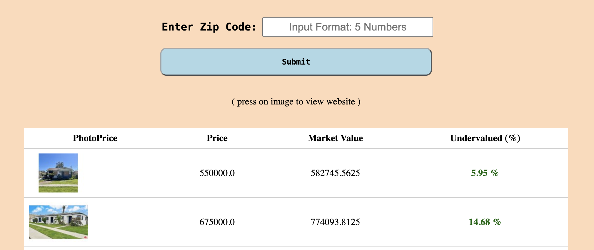
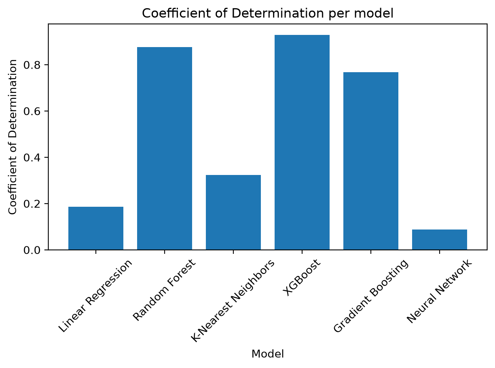
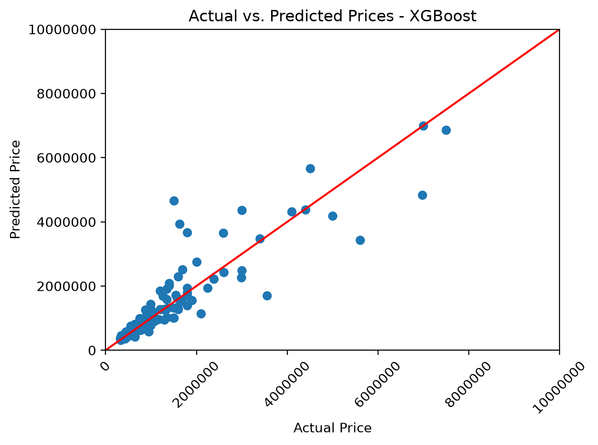
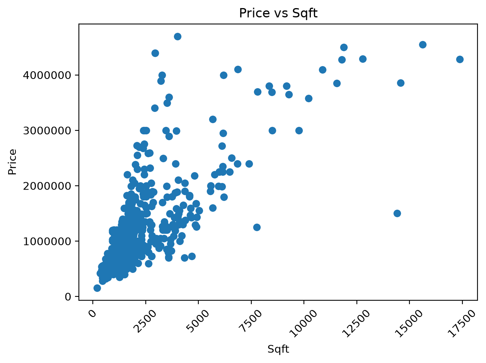
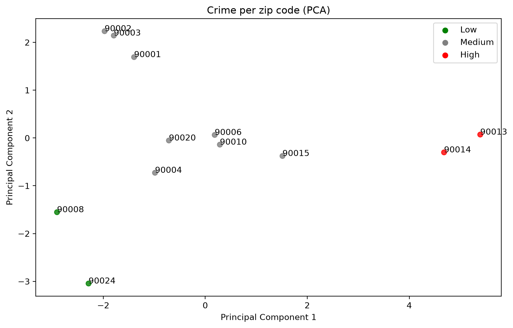

# Property Appraisal

This project is a comparative study of machine learning algorithms for property valuation.

This project also identifies properties priced below their market value by using XGBoost to estimates what each listing should be worth from its property attributes and its neighbourhood's crime and income statistics. Listings with an asking price below the estimate are ranked by how undervalued they are.

The data was scraped from a variety of sources and is used for educational purposes only.



## Results

XGBoost was the most accurate of the six models compared, so the app uses it.

<p>
  
  
</p>

The analysis also looked at how price relates to each property attribute, such as square footage, and grouped zip codes by their crime statistics.

<p>
  
  
</p>

## Run it

```bash
python -m venv .venv && source .venv/bin/activate
pip install -e ".[dev]"
flask --app property_appraisal.web run --port 5001
```

Open http://127.0.0.1:5001. See [TECHNICAL.md](TECHNICAL.md) for the data, features, model and evaluation details.
